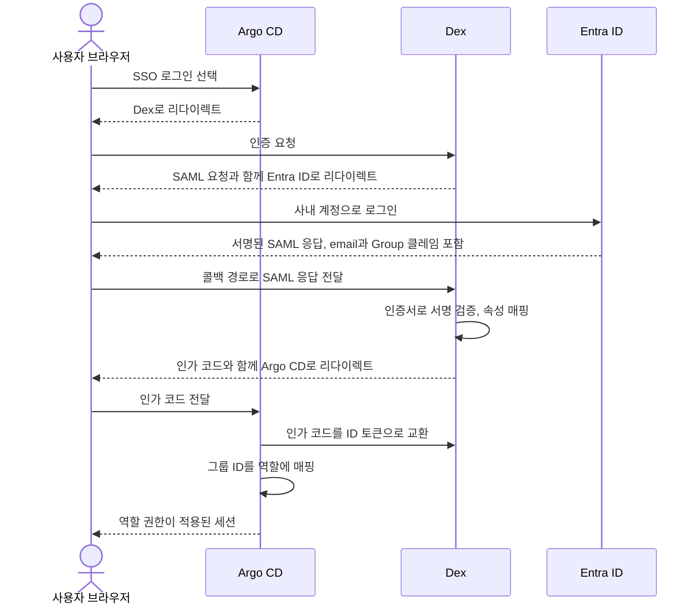

Argo CD에 내장된 Dex의 SAML 커넥터로 Microsoft Entra ID를 연동해, 사내 계정으로 로그인하고 Entra ID 그룹 단위로 권한을 부여받도록 구성한 과정을 정리했습니다.

## 왜 이 작업이 필요했나?

Argo CD는 별도로 설정하지 않으면 내장 admin 계정과 argocd-cm에 선언한 로컬 계정으로 사용자를 관리합니다. 하지만 사내 계정은 이미 Microsoft Entra ID(구 Azure AD)에서 관리하고 있었습니다. 이 상태에서 Argo CD만 자체 계정을 보유하면 두 체계가 별도로 운영되는데, 입사나 퇴사, 팀 이동이 Entra ID에 반영돼도 Argo CD 계정에는 자동으로 반영되지 않습니다. 누가 어떤 권한을 보유하는지도 Argo CD 설정 안에서 사용자 단위로 별도 관리해야 합니다.

따라서 이번 작업에서는 Argo CD 로그인을 Entra ID 사내 계정으로 처리하고, 권한은 개인이 아닌 Entra ID 그룹 단위로 부여하도록 구성했습니다. 대상은 개발 환경 EKS 클러스터에 Helm으로 설치한 Argo CD였습니다. Argo CD 설정은 Git 저장소의 Helm values 파일로 관리하고 있었기 때문에, Entra ID 측은 포털에서 구성하더라도 Argo CD 측 연동 설정은 콘솔에서 수동으로 변경하지 않고 values 파일에 선언해야 했습니다.

저는 Entra ID에 비갤러리 엔터프라이즈 애플리케이션을 생성해 사용자와 그룹을 할당하고, SAML 구성과 클레임, 서명 인증서를 준비하는 일부터 담당했습니다. Argo CD 측에서는 Dex SAML 커넥터와 RBAC 정책을 선언했고, 연동 과정에서 발생한 연결 오류도 직접 해결했습니다.

## 어떻게 해결했나

### Dex를 SAML Service Provider로 구성하기

Argo CD 공식 문서는 Entra ID와 연동하는 방법으로 App Registration을 사용하는 OIDC 방식과, Enterprise App을 생성하고 Dex를 경유하는 SAML 방식을 함께 안내하고 있습니다. 이번 구성은 그중 SAML Enterprise App + Dex 방식을 채택했습니다. Argo CD에는 Dex가 함께 배포되기 때문에 Dex가 SAML Service Provider 역할을 담당하고, Argo CD는 Dex가 발급한 OIDC 토큰만 신뢰하는 구조가 됩니다. 로그인 흐름은 다음과 같습니다.



이 방식에서는 Argo CD 설정에 Entra ID용 client secret을 저장하지 않고, Dex가 Entra ID의 공개 인증서로 SAML 응답의 서명만 검증합니다. 대신 서명 인증서에는 만료일이 있어서 갱신할 때마다 Dex 설정의 인증서 값도 함께 변경해야 하고, 인증 경로에 Dex가 추가로 개입한다는 점은 감수해야 합니다.

### 권한은 그룹 Object ID로, 역할은 필요한 만큼만

그룹 클레임은 그룹 ID를 반환하도록 설정했기 때문에 그룹 이름이 아닌 Object ID(GUID)로 전달됩니다. 따라서 RBAC 정책도 그룹 Object ID를 키로 삼아 역할에 매핑했습니다. 그룹 이름이 변경돼도 정책이 그대로 유지되고 이름이 같은 다른 그룹과 혼동될 우려도 없지만, 정책 파일만으로는 어느 그룹인지 식별할 수 없어서 어떤 ID가 어떤 그룹인지는 별도로 기록해야 합니다.


역할은 내장 <code>role:admin</code>을 그대로 부여하지 않고 커스텀 역할을 하나 생성했습니다. 모든 프로젝트의 애플리케이션에 대한 전체 권한과 클러스터 조회, 저장소 관리 권한만 포함하고, 클러스터 등록이나 삭제처럼 영향이 큰 작업은 제외했습니다. 새로운 종류의 작업이 필요해지면 그때마다 정책을 추가해야 하는 번거로움은 있습니다. 이 정책은 Dex 커넥터 설정과 함께 Argo CD Helm values 파일에 선언했고, 형태는 아래와 같습니다.

```txt
p, role:team-admin, applications, *, */*, allow
p, role:team-admin, clusters, get, *, allow
p, role:team-admin, repositories, get, *, allow
# repositories의 create, update, delete도 같은 형식으로 허용
g, "<Entra ID 그룹 Object ID>", role:team-admin
```

## 까다로웠던 부분

### 같은 값을 서로 다른 이름으로 지칭하는 두 화면

SAML은 IdP와 SP가 서로의 식별자와 주소를 정확히 동일한 문자열로 공유하고 있어야 동작합니다. 그러나 Entra ID 포털과 Dex 설정은 같은 값을 서로 다른 이름으로 지칭하고 있어서, 값 하나만 일치하지 않아도 로그인이 실패합니다. 두 설정의 대응 관계를 정리하면 다음과 같습니다.

| Entra ID 엔터프라이즈 앱 | Dex SAML 커넥터 |
| --- | --- |
| 식별자(엔터티 ID) | <code>entityIssuer</code> |
| 회신 URL(ACS URL) | <code>redirectURI</code> |
| Entra ID가 제공하는 로그인 URL | <code>ssoURL</code> |
| 인증서(Base64) 파일 | <code>caData</code> |
| 클레임 email | <code>usernameAttr</code>, <code>emailAttr</code> |
| 그룹 클레임 Group | <code>groupsAttr</code> |


식별자와 회신 URL에는 모두 Argo CD 주소 뒤에 Dex 콜백 경로(<code>/api/dex/callback</code>)를 추가한 동일한 값을 입력했고, Entra ID 측에만 있는 로그온 URL에는 Argo CD의 로그인 경로를 입력했습니다. Dex의 SSO 주소에는 Entra ID가 테넌트별로 제공하는 SAML 로그인 URL을 그대로 입력했습니다.


놓치기 쉬운 부분은 인증서였습니다. Entra ID에서 다운로드하는 "인증서(Base64)" 파일은 이미 PEM 텍스트인데, Dex의 <code>caData</code>에는 이 파일 내용을 한 번 더 base64로 인코딩한 값을 입력해야 합니다. 양측 이름에 모두 Base64가 포함돼 있어, 다운로드한 내용을 그대로 붙여 넣기 쉬운 부분입니다.

### 클레임 이름 일치시키기

Entra ID SAML 앱의 기본 클레임은 이메일 주소 같은 속성에도 긴 스키마 URI를 이름으로 사용합니다. Dex는 설정에 기재한 이름 그대로 SAML 속성을 조회하기 때문에, Dex 측에 맞춘 짧은 이름의 클레임을 별도로 추가했습니다. email 클레임에는 사용자의 메일 속성을 연결했고, Group은 그룹 클레임으로 생성해 반환 대상을 "모든 그룹", 원본 특성을 "그룹 ID"로 설정하고 이름만 Group으로 지정했습니다.


### argocd-server가 Dex에 연결되지 못하던 문제

설정을 반영한 뒤 argocd-server가 Dex의 OIDC discovery 엔드포인트를 조회하지 못하는 오류가 발생했습니다. 로그에는 Dex 서비스의 5556 포트로 openid-configuration을 요청하는 과정에서 <code>connection refused</code>로 거부됐다는 메시지가 기록돼 있었습니다. 보안 그룹에 5556 인바운드를 추가하자 연동이 동작했고, 초기에는 출발지를 전체로 허용해 동작을 확인한 뒤 Microsoft가 공개한 Entra ID 엔드포인트의 IPv4 대역 4개로 출발지를 축소해도 정상 동작하는 것을 확인했습니다. 당시에는 포트를 개방해 동작을 확인하는 데서 마무리했고, 이 규칙이 정확히 어느 구간의 연결을 허용한 것인지까지 검토하지는 않았습니다.

## 결과

개발 환경의 Argo CD에 사내 Entra ID 계정으로 SSO 로그인하는 흐름이 동작하게 됐습니다. 권한도 Entra ID 그룹 단위로 부여하게 되면서, 그룹에 구성원을 추가하고 제외하는 것만으로 Argo CD 권한이 함께 반영되므로 인원이 변경될 때마다 Argo CD 설정을 수정할 필요가 없어졌습니다. Dex 커넥터와 RBAC 정책은 Helm values로 Git에서 관리되므로 변경 이력을 추적할 수 있고, 연동 과정에서 개방한 포트의 허용 출발지는 전체 허용에서 Microsoft 공개 IPv4 대역 4개로 축소했습니다.

## 돌아보며

SAML 연동은 결국 두 시스템이 다른 이름으로 지칭하는 같은 값을 하나씩 일치시키는 작업이었고, 인증서처럼 이름만 보고 그대로 붙여 넣기 쉬운 값도 포함돼 있었습니다. 연동이 완료된 뒤에도 서명 인증서의 만료일은 남아 있어서, 갱신할 때마다 Dex 설정의 인증서 값도 함께 변경해야 한다는 점은 지속적으로 관리해야 할 부분입니다.

<b>기술 스택</b>: Argo CD, Microsoft Entra ID, SAML
