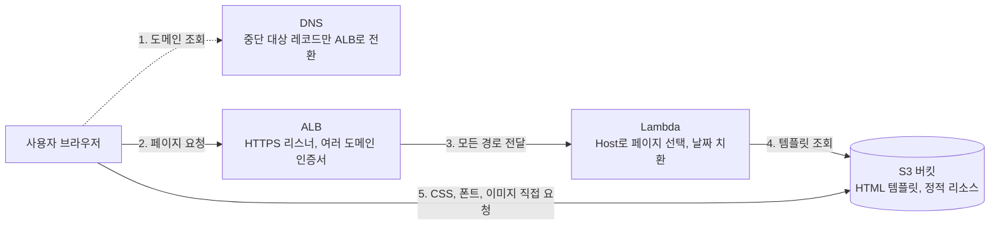

서비스를 중단해야 할 때마다 안내 페이지용 인프라를 새로 생성하고 삭제하던 방식을, 상시 대기하는 ALB 하나와 Lambda 함수 하나, S3 버킷 하나로 전환한 과정을 정리했습니다. 지금은 Lambda의 날짜 상수를 수정하고 중단할 서비스의 DNS 레코드를 ALB로 전환하는 두 단계로 중단 페이지를 게시합니다.

## 왜 이 작업이 필요했나?

저희가 운영하는 채용 플랫폼은 시스템 업데이트처럼 서비스를 중단해야 하는 작업이 있으면 사용자에게 "시스템 업데이트 안내" 페이지를 제공합니다. 이 페이지에는 업데이트 시작과 종료 일시, 그리고 업데이트가 완료되면 지원서 접수와 전형 결과 확인이 다시 가능하다는 안내가 포함됩니다. 기존에는 중단을 반영할 때마다 이 페이지를 제공할 인프라를 새로 생성하고, 작업이 완료되면 다시 삭제했습니다. 일정이 확정될 때마다 같은 생성과 삭제를 반복해야 했고, 이 번거로움이 개선의 출발점이었습니다.

조건이 단순하지는 않았습니다. 중단 페이지가 필요한 곳은 채용 사이트와 관리 화면(CMS), 그리고 별도 도메인을 사용하는 다른 서비스였고, 채용 사이트와 관리 화면은 서로 다른 루트 도메인 두 개 아래에서 서비스되고 있었습니다. 중단 페이지 인프라 하나가 이 도메인들의 HTTPS 요청을 모두 처리해야 했던 것입니다. 또한 중단 일시는 작업마다 다르고, 날짜를 표기하는 형식도 서비스마다 달랐습니다.

그래서 구조를 선정하기 전에 기준부터 다섯 가지로 정의했습니다. 유지보수가 매우 용이해야 하고, 신규 입사자가 봐도 아키텍처를 이해할 수 있어야 했고, AWS에 생성되는 리소스는 최대한 적어야 했습니다. 중단 배포 때마다 반복 작업이 최소화되어야 한다는 것과 비용이 많이 발생하지 않아야 한다는 것도 기준에 포함했습니다. 저는 이 기준으로 서빙 구조 대안을 검토하고, PoC부터 구현, 운영 절차 문서화까지 담당했습니다. 페이지 디자인(HTML/CSS)은 기획에서 전달받았고, 이 파일들이 새 구조에서 동작하도록 리소스 경로와 날짜 부분을 수정했습니다.

## 어떤 구조를 선택할지

### 도메인 제약이 결정을 좌우했다

후보는 CloudFront, API Gateway + Lambda, ALB + Lambda 세 가지였습니다.

| 대안 | 기대한 점 | 제약 사항 | 결론 |
| --- | --- | --- | --- |
| CloudFront | 가장 선호한 선택지 | 이미 CloudFront를 사용하는 서비스 도메인은 다른 Distribution에 Alternate domain으로 중복 등록할 수 없음 | 제외 |
| API Gateway + Lambda | ALB가 없어 비용 면에서 유리 | 서비스 도메인마다 Custom Domain을 등록해야 하고, DNS만 연결하는 방식은 동작하지 않음 | 제외 |
| ALB + Lambda | HTTPS 리스너 하나에 여러 도메인의 인증서를 등록할 수 있음 | ALB를 상시 유지하는 고정 비용 | 채택 |

처음에는 CloudFront를 적용할 수 있다면 가장 바람직하다고 판단했습니다. 하지만 이미 CloudFront 뒤에 있는 서비스는 동일한 도메인을 중단용 Distribution에 다시 등록할 수 없었습니다. 비용만 보면 API Gateway가 ALB보다 유리했는데, API Gateway는 Custom Domain으로 등록된 호스트로 유입된 요청만 해당 API로 연결하기 때문에 서비스 도메인을 개별적으로 등록하고 관리해야 했습니다. 서비스 도메인을 공용 중단 도메인에, 다시 execute-api 엔드포인트에 DNS로만 연결하는 방식은 동작하지 않았고, 중단 때마다 반복 작업을 최소화한다는 기준에도 부합하지 않았습니다.

최종적으로 남은 선택지는 ALB였습니다. ALB는 HTTPS 리스너에 여러 도메인의 인증서를 등록할 수 있어서, 중단 대상 도메인이 여러 개여도 동일한 진입점을 사용할 수 있습니다. ALB 비용은 감수하고, 나머지 구성 요소를 최소화하는 방향으로 결정했습니다.

### 웹 서버 대신 HTML 한 장만 반환하기

처음에는 Lambda의 실행 모델을 정확히 이해하지 못한 채 Flask 웹 서버를 그대로 배포하려 했습니다. 로컬에서 실행되던 코드를 배포하면 될 것으로 예상했는데, Lambda는 zip으로 패키징하든 컨테이너 이미지로 빌드하든 handler 함수가 진입점이어야 했습니다. Zappa로 배포하면 일단 동작은 했지만 CSS를 로드하지 못했고, 라이브러리가 자동으로 생성하는 리소스가 많고 복잡해서 유지보수하기 어려워 보였습니다. 컨테이너로 빌드해 ECS Fargate에 배포하는 방법도 동작은 할 것으로 보였습니다.

여기서 문제를 재검토했습니다. 중단 페이지의 역할은 HTML 한 장을 표시하는 것이 전부였기 때문에, 프레임워크 없이 Lambda handler가 HTML 문자열을 직접 반환하는 가장 단순한 방식을 선택했습니다.

### 최종 구조



구성은 ALB 1개, Lambda 함수 1개, S3 버킷 1개가 전부입니다. 평상시에는 어떤 DNS 레코드도 ALB를 가리키지 않으므로 트래픽 없이 대기하고, 중단할 때만 대상 서비스의 레코드를 ALB로 전환합니다. Lambda가 생성한 HTML은 ALB를 경유해 브라우저로 반환되고, 페이지에 필요한 CSS와 폰트, 이미지는 브라우저가 S3에서 직접 로드합니다.

## 까다로웠던 부분

### 상대 경로로 참조된 CSS와 폰트가 로드되지 않는 문제

기획에서 전달받은 HTML은 CSS를 상대 경로로 참조했고, CSS 안의 폰트 같은 리소스도 상대 경로였습니다. 일반 웹 서버라면 브라우저가 HTML을 수신한 뒤 그 경로로 CSS와 폰트를 다시 요청하고 서버가 해당 파일을 제공합니다. 그런데 이 구조에서는 ALB 리스너 규칙이 모든 경로를 Lambda로 전달하고, handler는 경로와 무관하게 HTML만 반환합니다. 브라우저가 CSS를 요청해도 HTML이 반환되므로 스타일이 적용되지 않았던 것입니다.

Lambda에 정적 파일 서빙 로직을 추가하는 대신, CSS와 폰트, 이미지를 S3의 공개 경로에 업로드하고 HTML과 CSS 안의 참조 경로를 모두 S3 절대 URL로 변경했습니다. 그 결과 Lambda는 HTML 문서 하나만 담당하고, 나머지 리소스는 브라우저가 S3에서 직접 로드하게 됐습니다.

### Lambda 하나로 서비스별 페이지 선택하기

서비스마다 Lambda를 별도로 두면 리소스가 증가하기 때문에, 함수 하나가 요청의 Host 헤더를 확인해 어느 서비스로 유입됐는지 판단해 그 서비스의 템플릿을 렌더링하게 했습니다. 도메인 접미사로 비교하므로 검사 순서가 중요했는데, 관리 화면은 채용 사이트와 동일한 루트 도메인을 사용하기 때문에 더 구체적인 관리 화면 패턴을 먼저 검사해야 채용 사이트 분기로 잘못 처리되지 않습니다. 어느 패턴에도 해당하지 않으면 채용 사이트용 기본 안내 페이지를 반환합니다. 아래는 도메인을 일반화하고 분기 구조만 남긴 발췌입니다.

```py
host = event["headers"]["host"]
# 관리 화면 패턴을 먼저 검사해야 채용 사이트 분기로 새지 않는다
if host.endswith(ADMIN_SUFFIXES):
    body = render_admin()
elif host.endswith(SITE_SUFFIXES):
    body = render_site()
elif host.endswith(OTHER_SUFFIX):
    body = render_other()
else:
    body = render_site()  # 알 수 없는 도메인은 기본 안내 페이지
```

handler는 statusCode, headers, body를 담은 값을 반환하고, ALB가 이를 HTTP 응답으로 변환합니다. Content-Type을 <code>text/html</code>로 지정해 두면 브라우저에 페이지가 그대로 표시됩니다.

### 중단 시 변경하는 값은 코드 최상단 상수로

HTML 템플릿에서 날짜가 들어갈 위치는 자리표시자로 치환해 S3에 업로드했습니다. Lambda는 파일 최상단에 선언한 연, 월, 일, 요일, 시작과 종료 시각 상수로 서비스마다 필요한 표기 형식의 문자열을 생성하고, S3에서 조회한 템플릿에 삽입해 반환합니다. 채용 사이트와 관리 화면은 "M월 D일 (요일)" 형태의 제목과 시작, 종료 일시를 모두 표시하고, 다른 서비스는 "오전 HH:00 \~ 오전 HH:00"처럼 시간대만 표시하는 방식입니다. 날짜 상수가 한 곳에만 정의되어 있으므로, 한 번 수정하면 모든 서비스의 중단 페이지에 같은 일정이 반영됩니다.

Lambda와 ALB는 Lambda 콘솔에서 ALB 트리거(HTTPS 443, 모든 경로)를 추가하는 방식으로 연결했습니다. 트리거를 생성하면 Target Group과 Listener Rule이 함께 생성되기 때문에, 직접 생성하고 관리할 리소스가 그만큼 감소한다는 점도 장점이었습니다.


## 결과

중단 작업은 두 단계로 단축됐습니다. 인프라를 생성하고 삭제하던 과정이 제거됐고, Lambda 상단의 날짜 상수를 수정한 뒤 중단 대상 DNS 레코드를 ALB로 전환하면 완료됩니다. 작업이 완료되면 레코드만 원래대로 복원하면 됩니다. 리소스는 ALB, Lambda 함수, S3 버킷 하나씩으로 고정됐고, 이 세 리소스가 두 루트 도메인에 걸친 세 종류의 중단 페이지를 함께 처리합니다. 새 서비스의 중단 페이지가 필요하면 HTML과 CSS를 버킷에 업로드하고 Lambda에 렌더 함수와 분기를 하나 추가하면 됩니다.

비용 측면은 구분해서 살펴봐야 합니다. 페이지 자체는 전용 서버 없이 요청이 있을 때만 과금되는 Lambda와 S3로 제공하지만, ALB는 상시 유지하므로 고정 비용이 발생합니다. 이 고정 비용을 감수하고 반복 작업을 제거한 구조라고 보는 것이 적절합니다. 구축 과정과 중단 시 사용하는 방법, 새 페이지를 추가하는 방법은 문서로 정리해 두었습니다.

## 돌아보며

서빙 구조를 결정한 것은 기술 선호보다 도메인이 이미 어디에 연결되어 있느냐였습니다. CloudFront와 API Gateway 모두 기능만 보면 충분했지만 기존 도메인 구성과 충돌해 제외됐고, Lambda 코드는 정적 리소스와 동적 응답을 분리하고 나서야 HTML 한 장을 생성하는 일로 단순화됐습니다. 다만 지금은 날짜가 코드 상수로 정의되어 있고 "오전"이 문자열에 고정돼 있어서, 오후 작업이면 코드를 수정해야 하고 서비스마다 일정이 다른 경우는 처리하지 못합니다.

<b>기술 스택</b>: AWS Lambda (Python), Amazon S3, Application Load Balancer
